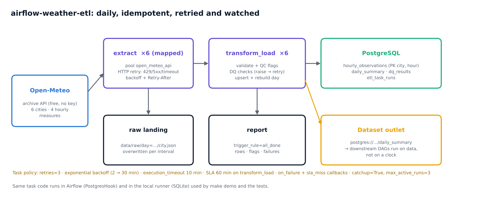
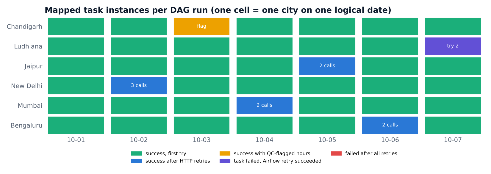
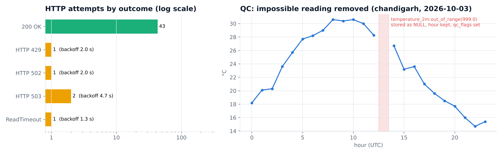
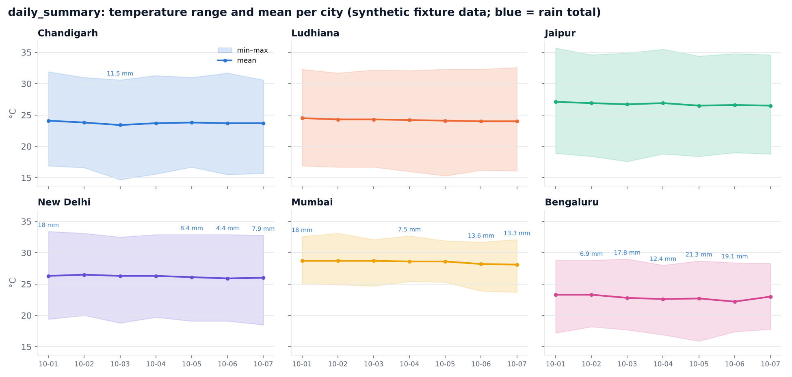

# Airflow Weather ETL

[](https://github.com/vishavjit-singh/airflow-weather-etl/actions/workflows/ci.yml)


A daily **Apache Airflow** pipeline that pulls hourly weather for six Indian cities from the free [Open-Meteo](https://open-meteo.com/) archive API. It validates the data, loads it into **PostgreSQL** and builds a daily summary. The pipeline is about what makes an orchestrated ingestion job trustworthy:

- **two layers of retries** that don't multiply into a retry storm
- **data-quality checks** that fail the task and let Airflow try again later
- an **SLA** with alert callbacks
- a **pool** that caps API concurrency during backfills
- **idempotent, data-interval-based loads**, so `catchup`, backfills and `tasks clear` are always safe

The task bodies live in a plain Python package. The DAG file only wires them together, and the same code runs in Airflow (PostgresHook) and in a local runner (SQLite) used by `make demo` and the tests.



## Why this project

| Problem in API ingestion | How the pipeline handles it |
|---|---|
| Free APIs return `429` and `5xx` and time out | **HTTP-level retries** inside a task: exponential backoff (1, 2, 4, 8 s) with jitter, `Retry-After` honoured and capped, fail fast on other `4xx` |
| A longer outage, or retries at two layers multiplying (5 HTTP attempts × 4 task tries) | HTTP retries stop after 5 attempts and fail the task. Airflow then **retries the task** with exponential backoff (2 → 30 min). Each layer has its own budget |
| The archive lags: today's file is missing hours | DQ check `hours_present ≥ 22` raises `DataIncomplete`, so the task fails and Airflow tries again later instead of publishing a short day |
| A sensor sends 999 °C | Range checks set the value to `NULL`, keep the hour and record why in `qc_flags`. Too many NULLs for a measure (> 10%) fails the day |
| Backfilling a month must not hammer the API | Every `extract` runs in the **`open_meteo_api` pool** (2 slots) with `max_active_runs=3` |
| Re-running a day must not duplicate rows | Loads are scoped to the **data interval**: upsert on `(city_id, observed_at)` plus delete-and-rebuild of that city-day's summary, in one transaction. Raw files are overwritten per interval |
| Nobody notices a late or failed run | `sla` on `transform_load`, plus `on_failure_callback` and `sla_miss_callback` that log a structured `ALERT` line ready for any log-based alerting |
| Downstream jobs run on a timer and read stale data | `transform_load` publishes a **Dataset** (`postgres://weather_db/public/daily_summary`), so consumers can be scheduled on fresh data instead |
| One slow city blocks the rest | **Dynamic task mapping**: one `extract` and one `transform_load` per city, so a city can fail and retry on its own. `report` uses `trigger_rule="all_done"` |

## Results from the demo run

`make demo` backfills one week (2026-10-01 → 07) for the six cities through the same task functions the DAG calls. It uses the local runner, SQLite and the **deterministic fixture source**: synthetic hourly data in Open-Meteo's exact JSON shape, with planned faults. HTTP backoff and Airflow retry delays are recorded rather than slept, so the week runs in seconds. Every image below is rendered from the tables and logs that run wrote.

**One cell per mapped task instance**, like Airflow's grid view. Blue cells are instances that needed HTTP retries. Purple is Ludhiana on 10-07: the archive was incomplete on the first try (19 of 24 hours), the task failed its DQ check, and the Airflow retry succeeded. Amber is a day with a QC-flagged hour:



**HTTP attempts by outcome**, and the impossible reading that QC removed:



**`daily_summary`**, built from the loaded hours:



| Metric (demo run, fixture source) | Value |
|---|---|
| DAG runs × mapped cities | 7 × 6 = 42 task instances, 0 failed in the end |
| Instances that needed an Airflow task retry | 1 (`DataIncomplete`: 19 of 24 hours on try 1) |
| HTTP calls | 48, of which 5 were retried: 2 × `503`, `429` (Retry-After 2 s), `502`, `ReadTimeout` |
| Backoff that would have been slept | 10.0 s in total |
| Rows loaded | 1,008 hourly observations (42 × 24) · 42 daily summary rows |
| DQ check results | 256 pass · 1 warn (QC-flagged hour) · 1 fail (the incomplete day, then retried) |
| Re-running the whole backfill | Identical tables (tested) |

> The fixture data is **synthetic**: plausible October patterns from a seeded generator, not real observations. Run with `--source api` (or `WEATHER_SOURCE=api` in Docker) to load the real Open-Meteo archive.

## The DAG

```python
@dag(schedule="@daily", catchup=True, max_active_runs=3, default_args={
        "retries": 3, "retry_exponential_backoff": True, "max_retry_delay": timedelta(minutes=30),
        "execution_timeout": timedelta(minutes=10), "on_failure_callback": _alert},
     sla_miss_callback=_sla_miss)
def weather_etl():
    city_ids = cities()
    create_tables() >> city_ids
    extracted = extract.expand(city_id=city_ids)                         # pool="open_meteo_api"
    report(transform_load.expand(extracted=extracted))                   # sla=60 min, outlets=[Dataset]
```

Full file: [`dags/weather_etl_dag.py`](dags/weather_etl_dag.py). Task bodies: [`tasks.py`](src/weather_etl/tasks.py), [`client.py`](src/weather_etl/client.py), [`transform.py`](src/weather_etl/transform.py), [`quality.py`](src/weather_etl/quality.py), [`load.py`](src/weather_etl/load.py).

## Tables

| Table | Grain | Written by |
|---|---|---|
| `hourly_observations` | city × UTC hour: 4 measures + `qc_flags`, `run_id` | upsert on `(city_id, observed_at)` |
| `daily_summary` | city × day: min/max/mean temperature, humidity, rain total, max wind, flagged hours | delete + insert for the city-day |
| `dq_results` | one row per check, city, day and try | replaced per try |
| `etl_task_runs` | one row per task try: state, duration, HTTP calls, rows, error | written by the local runner (in Airflow, the metadata DB holds this) |

DDL for PostgreSQL: [`sql/schema_postgres.sql`](sql/schema_postgres.sql), generated by `make schema`.

## Quickstart

```bash
git clone https://github.com/vishavjit-singh/airflow-weather-etl.git
cd airflow-weather-etl
python -m venv .venv && source .venv/bin/activate
make install
make demo     # backfill a week locally (SQLite, fixture source) → charts → summary
make test     # 21 tests; +1 PostgreSQL test with PG_DSN set, +2 DAG tests with Airflow installed
```

### Airflow + PostgreSQL in Docker

```bash
docker compose up --build            # UI: http://localhost:8080 (admin / admin), DAG "weather_etl"
WEATHER_SOURCE=fixture docker compose up --build   # offline, deterministic
```

`airflow-init` migrates the metadata DB, creates the admin user and the `open_meteo_api` pool. A second database (`weather`) on the same PostgreSQL receives the data through the `weather_db` connection.

### CLI

```bash
python -m weather_etl run --start 2026-10-01 --end 2026-10-07 [--source api] [--db postgresql://…]
python -m weather_etl report        # charts in docs/images
python -m weather_etl summary       # the numbers above, as JSON
python -m weather_etl schema --dialect postgres
```

## Project structure

```
├── dags/weather_etl_dag.py      # TaskFlow DAG: mapping, pool, retries, SLA, callbacks, Dataset
├── config/pipeline.yaml         # cities, measures, retry budget, DQ thresholds, SLA
├── src/weather_etl/
│   ├── client.py                # Open-Meteo client: backoff, jitter, Retry-After, fail-fast 4xx
│   ├── fixtures.py              # deterministic API stand-in with planned faults (synthetic data)
│   ├── transform.py             # payload contract + interval filter + range QC
│   ├── quality.py               # day-level checks → DataIncomplete / DataQualityError
│   ├── db.py                    # PostgreSQL / SQLite wrapper and DDL
│   ├── load.py                  # idempotent upsert + daily rebuild in one transaction
│   ├── tasks.py                 # task bodies shared by the DAG and the local runner
│   ├── runner.py                # local runner with Airflow's retry policy
│   ├── report.py · cli.py
├── tests/                       # unit + end to end; tests/airflow = DagBag checks
├── docker-compose.yml · Dockerfile · docker/init-db.sql
└── .github/workflows/ci.yml     # tests on SQLite + PostgreSQL, an Airflow `dags test` run, compose build
```

## Testing

```bash
make lint && make test
```

- **Client:** backoff growth and jitter bounds, `Retry-After` honoured and capped, giving up after 5 attempts without a pointless final sleep, fail-fast `4xx`, and faults replayed only on the first task try
- **Transform and quality:** UTC interval filtering, out-of-range values nulled and flagged, duplicate timestamps, contract breaks, and the incomplete and too-many-nulls failures
- **Load:** idempotent re-runs, summary values against the raw hours, corrections overwrite old values, days isolated from each other, and PostgreSQL parameter style
- **Runner:** a week of backfill end to end, the exact retry and failure pattern, an identical result on re-run, and a day that never completes failing after 1 + 3 tries without publishing a summary
- **CI only:** the backfill against a real PostgreSQL service, DagBag import and policy checks, and `airflow dags test weather_etl 2026-10-02` with the fixture source, whose results are then queried in PostgreSQL

The PostgreSQL DDL, upsert and daily-rebuild statements were also run by hand against a local PostgreSQL 16.

## Limitations and roadmap

- The DAG was written for Airflow 2.10 but has not been run outside CI. Its first execution is the CI `airflow` job, and the Docker Compose stack has only been built in CI, not run.
- SLAs are an Airflow 2 feature. Airflow 3 replaces them with deadline alerts, so the callback would need porting.
- Alerts are structured log lines. Wiring them to Slack or email through an Airflow notifier is a small next step.
- Next: a downstream DAG scheduled on the `daily_summary` Dataset (weekly anomalies), and Great Expectations or dbt tests on the warehouse side.

## Author

**Vishavjit Singh Saini**, Data Engineer
[Portfolio](https://vishavjit-singh.pages.dev/) · [LinkedIn](https://www.linkedin.com/in/vishavjit-singh-7011211ab/) · [GitHub](https://github.com/vishavjit-singh)

## License

[MIT](LICENSE)
